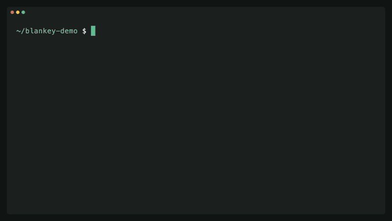

# Blankey

Local, offline tray app that keeps personal data encrypted and fills document templates. An MCP server lets an AI
assistant (any MCP client) design templates, test them with invented data, and ask for real documents, without ever
seeing the real values.

Website and download: [blankey.io](https://blankey.io)

[](https://blankey.io)

Built with Rust + Tauri. It replaces the earlier Python/Qt app and keeps its data format: `vault.db`, `templates/`,
`config.toml` and the keychain entry are shared, so an existing vault opens unchanged (see
`vault::tests::reads_python_vault`).

## Run

```bash
scripts/fetch-pdfium.sh          # once: PDFium for page rendering and text extraction
cd src-tauri
cargo run                        # debug builds use ~/Library/Application Support/Blankey Preview
cargo test
cargo fmt && cargo clippy --all-targets
cd .. && npm install && npm test # UI tests (Node, happy-dom), no build step
```

`BLANKEY_DATA_DIR=/some/dir` picks another data dir. Release builds use the per-user data directory
(`~/Library/Application Support/Blankey` on macOS); `scripts/copy-python-data.sh` copies it into the preview folder.

## Release builds

Each script builds on its own platform and copies the installers and `THIRD_PARTY_LICENSES.html` to `dist/`.
They need `cargo install tauri-cli --version "^2"` and `cargo install cargo-about`.

| Platform | Script | Output |
|---|---|---|
| macOS (Apple Silicon) | `scripts/build_mac.sh` | `.dmg` |
| Windows x86-64 | `scripts/build_windows.ps1` | NSIS `.exe` and `.msi` |
| Debian 13 trixie, Ubuntu 26.04 | `scripts/build_deb.sh --install-deps` (on that release) | `.deb` per release |

`scripts/build_deb_docker.sh debian:trixie` (or `ubuntu:26.04`) runs the .deb build in a container locally.
PDFium is fetched for the platform and bundled next to the app. `.docx` output is converted to PDF when
LibreOffice is installed.

To release: bump the version in `src-tauri/Cargo.toml` and `src-tauri/tauri.conf.json`, update `CHANGELOG.md`,
then publish a GitHub release tagged `v<version>`. `.github/workflows/release.yml` builds every platform while the
tests (`ci.yml`, also run on pushes to main and PRs) run alongside, and uploads the installers to that release once
both pass. A manual run without a tag only builds and keeps the installers as workflow artifacts; with a tag it
uploads to that existing release. Rust caches are saved only on main, so a manual run on main before tagging warms
the build caches.

## First launch

Builds are not code-signed, so the OS blocks the first launch:

1. macOS: open the DMG and drag Blankey to Applications. Open it once; macOS says it cannot verify the developer.
   Open System Settings → Privacy & Security and click "Open Anyway" (or run
   `xattr -dr com.apple.quarantine /Applications/Blankey.app`). Windows: SmartScreen → "Run anyway".
2. Blankey lives in the menu bar / system tray. First launch creates the vault (master password + one-time
   recovery key).
3. Connect an agent from the tray: Connect MCP → Configure Claude Desktop, or copy a connect command.

Linux: the tray needs StatusNotifier support (GNOME: AppIndicator extension).

## Connect an AI assistant

The server listens on `http://127.0.0.1:8765/mcp` (streamable HTTP, JSON responses); it moves to the next free port
when 8765 is taken. Any MCP client can connect; menu bar → Connect MCP has shortcuts for common ones:

- **Claude Desktop**: "Configure Claude Desktop" adds `Blankey mcp` (a stdio bridge that starts the app if needed).
- **Claude Code**: `claude mcp add --transport http blankey http://127.0.0.1:8765/mcp`
- **Codex**: `codex mcp add blankey --url http://127.0.0.1:8765/mcp`
- **Other clients**: "Copy MCP address" copies the HTTP endpoint.

Only loopback connections are accepted and foreign Host/Origin headers are refused.

## How the PII boundary works

- Profile values are AES-256-GCM encrypted per field. A random data key is wrapped by the master password
  (Argon2id), optionally by the OS keychain, and by a recovery key.
- Field keys, labels, types and value lengths are plaintext metadata. That is all MCP can read.
- MCP tools render templates only with example data. Real documents are rendered in the app, after the user
  approves the request, and stored encrypted. Only metadata goes back to the assistant.
- Requests from the assistant (`request_profile_input`, `request_fill`) open a dialog in the app; the assistant
  blocks on `wait_request` until the user saves, approves or cancels.
- Request payloads and results are sealed to a request key pair (X25519 + AES-GCM): stored while the vault is
  locked, readable only after unlocking. The Activity page needs an unlocked vault.
- `mcp::tools::tests::no_tool_leaks_vault_values` pushes sentinel values through every tool and asserts they never
  come back.

## Templates

`templates/<id>/manifest.yaml` maps each PDF field / template variable to a Jinja expression over roles, e.g.
`{{ applicant.address.permanent.city }}` or `{{ loan.amount | money }}`. Kinds:

- `pdf_form`: fills an AcroForm. Text is drawn with the bundled Noto Sans (Latin, Cyrillic, Greek) and flattened;
  checkboxes / radios use their native on-state.
- `typst`: `main.typ` reads `json(bytes(sys.inputs.data))`.
- `docx`: Jinja tags in the document text; converted to PDF only if LibreOffice is installed.

### Flat PDFs

PDFs without form fields (exports, scans) become `pdf_form` templates through the assistant: `inspect_pdf_layout`
shows each page with a coordinate grid and the printed text positions, and `save_pdf_overlay_template` takes the flat
PDF plus boxes (`{name, page, rect, type: text|check}` in PDF points) and field bindings, adds real form fields and
returns the pages with the boxes outlined. The original is kept as `flat.pdf`, so boxes can be corrected later.

### Filled .docx documents and fill sets

The assistant turns an existing filled .docx into a template with `inspect_docx` + `save_docx_template` (text spans
become `{{ var }}` tags; use the same var names across related documents). `request_fill` opens a form listing every
blank of one or more templates with its surrounding text; per blank you pick a vault field (`manager.egn`), a literal
the assistant proposed (non-PII only), the template default, or type a value. Documents are always generated from a
fill set. The choices are saved as a named fill set, encrypted in the vault, and can be reopened, regenerated,
exported (YAML, or a zip with the templates) and imported from tray → "Fill sets…".

## Layout

- `src-tauri/src/vault.rs`, `crypto.rs`, `keychain.rs`: SQLite vault, AES-256-GCM per field, Argon2id-wrapped keys,
  X25519-sealed requests, keychain / Touch ID unlock, rotating backups
- `src-tauri/src/templates/`: template store, Jinja bindings (minijinja), docx tokenizing and rendering, Typst,
  fill sets, previews
- `src-tauri/src/render/`: AcroForm filling with an embedded subset of Noto Sans (lopdf), PDFium previews
- `src-tauri/src/mcp/`: MCP server (axum) and the `blankey mcp` stdio bridge
- `src-tauri/src/app/`: tray, window, auto-lock, request handling and the commands the UI calls
- `ui/`: Preact + htm components (vendored in `ui/vendor`), loaded as ES modules with no build step. `ui/js/main.js`
  boots, `pages/` has one file per page, `fill/` the fill form. `ui/tests/` runs the real UI in happy-dom against a
  fake backend; release builds package `ui/` without the tests (`scripts/stage-ui.sh`)

## License

MIT. See [LICENSE](LICENSE). The bundled Noto fonts are under the SIL Open Font License
(`src-tauri/assets/fonts/OFL.txt`). `scripts/licenses.sh` lists every Rust dependency with its license text
(cargo-about, accepted licenses in `src-tauri/about.toml`), plus PDFium (BSD-3-Clause), Noto Sans (OFL) and the
Typst fonts, in `THIRD_PARTY_LICENSES.html`, which ships inside each package.
